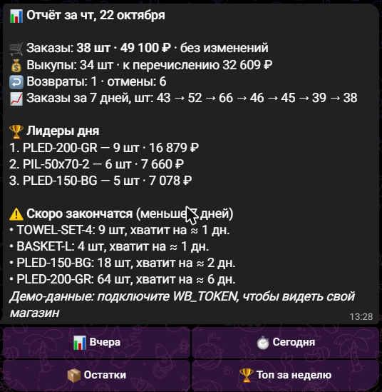
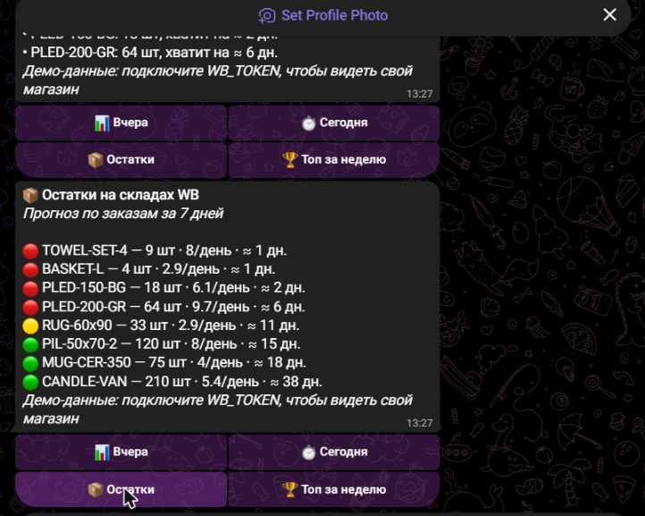

# 📦 Бот-аналитик для селлера Wildberries

Telegram-бот, который каждое утро присылает владельцу магазина сводку за вчера: заказы, выкупы, возвраты, лидеров продаж и товары, которые скоро закончатся. По кнопке — остатки с прогнозом и топ товаров за неделю.

Работает через официальный API продавца Wildberries. Без токена WB запускается на демо-данных.

 

## Что умеет

- **Ежедневный отчёт** в заданное время (по умолчанию 09:00 МСК): заказы и сумма, сравнение с предыдущим днём, выкупы и сумма к перечислению, возвраты и отмены, заказы по дням за неделю
- **Лидеры дня** — три товара с наибольшей выручкой
- **Прогноз остатков**: на сколько дней хватит товара при текущем темпе заказов; предупреждение, если меньше 7 дней (порог настраивается)
- **Команды и кнопки**: `/report` — за вчера, `/today` — сегодня на текущий момент, `/stocks` — все остатки со светофором 🔴🟡🟢, `/top` — топ-10 за 7 дней
- **Закрытый доступ**: бот отвечает только владельцу и тем, чьи ID указаны в настройках

## Как устроено

- Заказы и продажи — `statistics-api.wildberries.ru` (`/api/v1/supplier/orders`, `/api/v1/supplier/sales`), с догрузкой, если строк больше 80 000
- Остатки — отчёт `warehouse_remains` из `seller-analytics-api.wildberries.ru` в три шага: создать задание → дождаться готовности → скачать
- У WB лимит 1 запрос в минуту на метод, а данные обновляются раз в 30 минут, поэтому ответы кэшируются на 30 минут
- Понятные сообщения об ошибках WB: неверный токен, нет доступа к категории, превышен лимит
- Все даты — по Москве, как в API WB
- 9 автотестов: расчёты, прогноз, работа с API на подменённом `fetch`, расписание

## Стек

Node.js 24 · TypeScript · grammY · `fetch` · `node:test`. Без базы данных и лишних зависимостей.

## Структура

```
src/
├── index.ts          # запуск бота и ежедневной рассылки
├── bot.ts            # команды, кнопки, доступ
├── report.ts         # тексты отчётов
├── analytics.ts      # расчёты: сводка за день, топ, прогноз остатков
├── scheduler.ts      # запуск каждый день в заданное время
├── print-report.ts   # отчёт в консоль, без Telegram
└── wb/
    ├── client.ts     # клиент API Wildberries
    ├── demo.ts       # демо-магазин для показа без токена
    └── types.ts      # поля ответов API
```

## Запуск

Нужен **Node.js 24+**.

```bash
npm install
npm run report           # отчёт за вчера в консоль (демо-данные)
npm run report stocks    # остатки
```

С Telegram:

1. Создайте бота у [@BotFather](https://t.me/BotFather), скопируйте `.env.example` в `.env`, вставьте `BOT_TOKEN`.
2. `npm start`, напишите боту `/myid`, впишите ID в `ADMIN_IDS`, перезапустите.
3. Для своего магазина создайте токен в личном кабинете WB (Настройки → Доступ к API) с категориями **«Статистика»** и **«Аналитика»** и вставьте в `WB_TOKEN`.

| Переменная | Зачем |
|---|---|
| `BOT_TOKEN` | токен Telegram-бота |
| `WB_TOKEN` | токен API продавца WB; без него — демо-данные |
| `ADMIN_IDS` | кто пользуется ботом и получает отчёт |
| `REPORT_TIME` | время утреннего отчёта, МСК (по умолчанию `09:00`) |
| `LOW_STOCK_DAYS` | порог «скоро закончится», дней (по умолчанию `7`) |
| `TELEGRAM_PROXY` | HTTP-прокси, если `api.telegram.org` недоступен с сервера |

**Что можно добавить за доплату:** Ozon, несколько магазинов в одном боте, выгрузку в Google Таблицы, графики картинкой, отчёт по рекламе, уведомления о новых отзывах.
